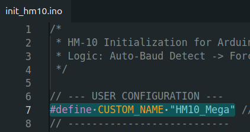
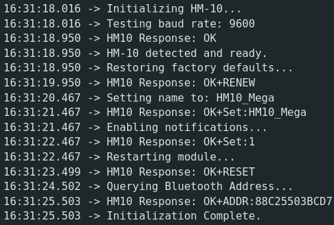
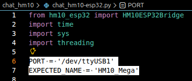
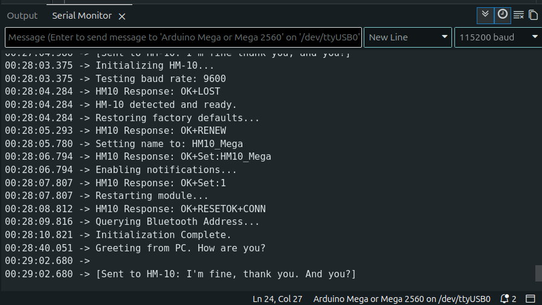
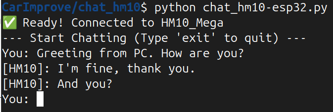

# Beginner Guide

This guide is for students. It shows how to set up the Bluetooth module on your car and how to send text between your PC and the car. You do not need to know anything about the ESP32 or about how Bluetooth works.

## What you get

Your car carries an **HM-10** module. It speaks **BLE** (Bluetooth Low Energy, the low-power kind of Bluetooth; it is not compatible with the older HC-05 modules). Whatever your PC sends arrives on the Arduino Mega's `Serial3`, and whatever the Mega prints to `Serial3` arrives on your PC.

There are two ways for your PC to reach the HM-10. Pick one:

| Way | What you need | Pick it when |
|---|---|---|
| **A. Through the ESP32** | A small ESP32 board on a USB cable (the TAs give you one, already programmed) | Your PC has no Bluetooth, or its Bluetooth is unreliable. Works the same on Windows, macOS and Linux. |
| **B. Your PC's own Bluetooth** | A PC with Bluetooth 4.0 or newer (every laptop from the last few years) | You do not want an extra board. |

Both ways use the same Step 1. Then do Step 2A or Step 2B.

## Step 1: Set up the HM-10

### Wiring

Connect the HM-10 to your Arduino Mega:

| HM-10 pin | Arduino Mega pin |
|-----------|------------------|
| VCC       | 5V               |
| GND       | GND              |
| TX        | RX3 (pin 15)     |
| RX        | TX3 (pin 14)     |

The course's HM-10 sits on a black base board that takes 5 V. If you use a different HM-10 with no base board, ask a TA before powering it: a bare module needs 3.3 V.

### Give the HM-10 a name

The name is how your PC finds your car among all the others, so make it unique to you.

1. Open [init_hm10/init_hm10.ino](init_hm10/init_hm10.ino) in the Arduino IDE.
2. Change `CUSTOM_NAME` to your own name. At most 12 characters, no spaces.

    

3. Connect the Mega to your PC by USB and upload the sketch.
4. Open the Serial Monitor at 115200 baud (that is the USB link between the Mega and your PC; the HM-10 itself talks to the Mega at 9600 baud, and your own car code must use `Serial3.begin(9600)`). The sketch finds the module, puts it back to factory settings, sets the name, and prints the module's address. It should end with a line like the one in the picture.

    

After this the sketch keeps running as a simple chat: anything you type in the Serial Monitor goes to the HM-10, and anything the HM-10 receives is printed. You can use this to test Step 2 before you write your own car code.

## Step 2A: Chat through the ESP32

### Install the Python package

Open a terminal (Windows: PowerShell; macOS: Terminal; Linux: any shell) and run:

```bash
pip install pyserial
```

### Find the ESP32's port

1. Plug the ESP32 into your PC by USB.
2. Find the serial port it was given:
    - **Windows**: Device Manager, under "Ports (COM & LPT)" (or "連接埠"). Look for something like `COM3`.
    - **Linux**: run `ls /dev/ttyUSB*`. Look for something like `/dev/ttyUSB0`.
    - **macOS**: run `ls /dev/tty.usbserial*`. Look for something like `/dev/tty.usbserial-0001`.

    If nothing shows up, your PC is missing the CH340 driver (the USB chip on the ESP32 board). Install it with the [CH340 driver slides](https://docs.google.com/presentation/u/0/d/1AppyLZE2i848UmYqMS-MMrL8-V6ORkutv9SstkJ2Zmo) and plug the board in again.

### Run the chat

1. Open [chat_hm10/chat_hm10-esp32.py](chat_hm10/chat_hm10-esp32.py) in any editor. On the two lines near the top, set `PORT` to the port you found and `EXPECTED_NAME` to the name you gave the HM-10 in Step 1.

    

2. In the terminal, go into the `chat_hm10` folder and run the script:

        cd chat_hm10
        python chat_hm10-esp32.py

    The script tells the ESP32 which HM-10 to look for (the ESP32 remembers it, even after a power cycle), waits for the link, and prints `✨ Ready! Connected to <your name>`.

3. Type a message and press Enter. It appears in the Arduino Serial Monitor. Type in the Serial Monitor and it appears in the terminal. Type `exit` to quit.

     

## Step 2B: Chat from your PC's own Bluetooth (no ESP32)

1. Turn on Bluetooth on your PC. Unplug any ESP32 that is connected to your HM-10: the HM-10 accepts only one connection at a time.
2. Install the Python package:

        pip install bleak

3. Open [chat_hm10/chat_hm10-bleak.py](chat_hm10/chat_hm10-bleak.py). Near the bottom, in `main()`, change `target_name="HM10_Mega"` to the name you gave the HM-10 in Step 1.
4. In the terminal, go into the `chat_hm10` folder and run:

        cd chat_hm10
        python chat_hm10-bleak.py

    The script scans for up to 10 seconds, prints `✅ Connected to <your name>`, and the chat works like in Step 2A. On macOS the first run asks for permission to use Bluetooth; allow it and run again.

## Use it from your own program

Both chat scripts are short; copy from them. The smallest useful pieces are below. Run your script from the `chat_hm10` folder (or copy the `hm10_esp32` or `hm10_bleak` folder next to your script) so Python finds the module.

**Through the ESP32 (Step 2A):**

```python
from hm10_esp32 import HM10ESP32Bridge

bridge = HM10ESP32Bridge('/dev/ttyUSB0')   # your port, e.g. 'COM3' on Windows
if bridge.get_status() == "CONNECTED":
    bridge.send("forward\n")      # to the car; '\n' marks the end of the message
    text = bridge.listen()        # all text from the car since the last call
bridge.close()
```

The ESP32 keeps the HM-10 name you set with `chat_hm10-esp32.py`, so you only need to run that script once per ESP32.

**Your PC's own Bluetooth (Step 2B):**

```python
import asyncio
from hm10_bleak import HM10BleakClient

async def main():
    hm10 = HM10BleakClient(target_name="HM10_Mega")   # your HM-10's name
    if await hm10.connect():
        await hm10.send("forward\n")   # to the car; '\n' marks the end of the message
        await asyncio.sleep(0.5)
        print(hm10.listen())           # all text from the car since the last call
        await hm10.disconnect()

asyncio.run(main())
```

**On the car:** use `Serial3.begin(9600)` and read with `Serial3.readStringUntil('\n')`. The HM-10 also prints `OK+CONN` when the PC connects and `OK+LOST` when it disconnects, so skip any line that starts with `OK+`, for example `if (line.startsWith("OK+")) return;`.

Three things to know, whichever way you use:

- The HM-10 sends at most 20 bytes per Bluetooth packet. A longer message still arrives, but in two or more pieces, and on the PC the pieces may come from two different `listen()` calls. That is why the examples end each message with `\n`: the car reads until `\n`, and on the PC you add what `listen()` returns to a string and split it at `\n`.
- `listen()` does not wait. It returns what has arrived so far, often an empty string. Call it in a loop with a short sleep.
- Do not start a message with `AT`. Both the HM-10 and the ESP32 treat such text as a command for themselves.

## If something goes wrong

| What you see | What to check |
|---|---|
| No serial port appears for the ESP32 | Install the CH340 driver (Step 2A) and try another USB cable; some cables carry power only. |
| `ESP32 is DISCONNECTED` | Is the HM-10 powered? Its LED blinks while it waits for a connection and stays on once connected. Is `EXPECTED_NAME` exactly the name from Step 1? The ESP32 searches in rounds of 30 seconds; wait a minute and run the script again. |
| `Target mismatch` followed by `Name updated` | Normal the first time you use an ESP32. The script told the ESP32 your HM-10's name and restarted it. |
| `Device not found` (Step 2B) | Is Bluetooth on? Is the name right? Is an ESP32 still connected to this HM-10? Unplug it. |
| You send text but nothing reaches the car, or the other way round | TX and RX swapped in the wiring table. Check that the car code uses 9600 baud on `Serial3`. |
| `Access is denied` or `could not open port` | Another program has the port open: close the Arduino Serial Monitor or an old chat script. |

Anything else: ask a TA. The TA's own guide is [TA_GUIDE.md](TA_GUIDE.md).
